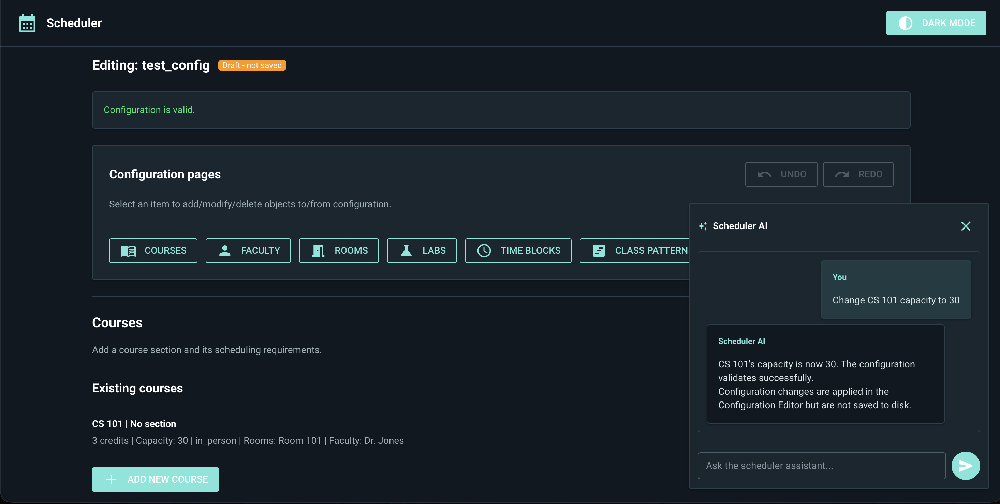
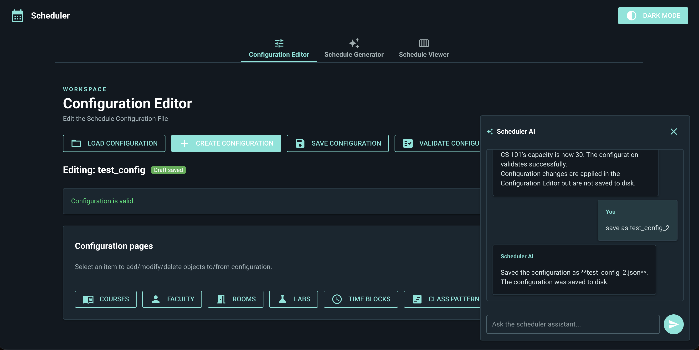
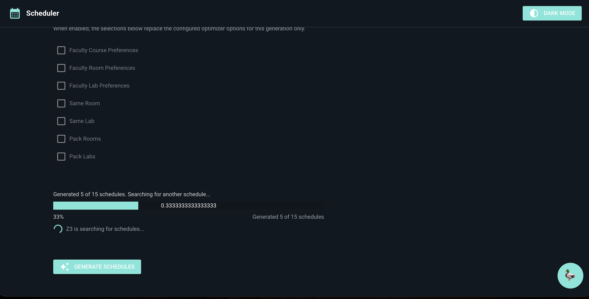
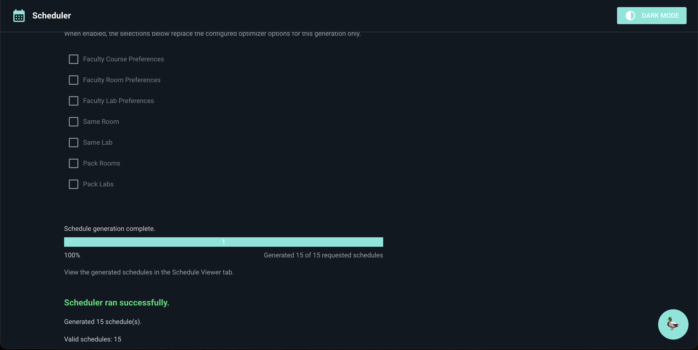
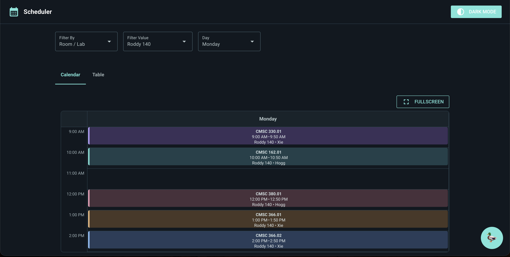
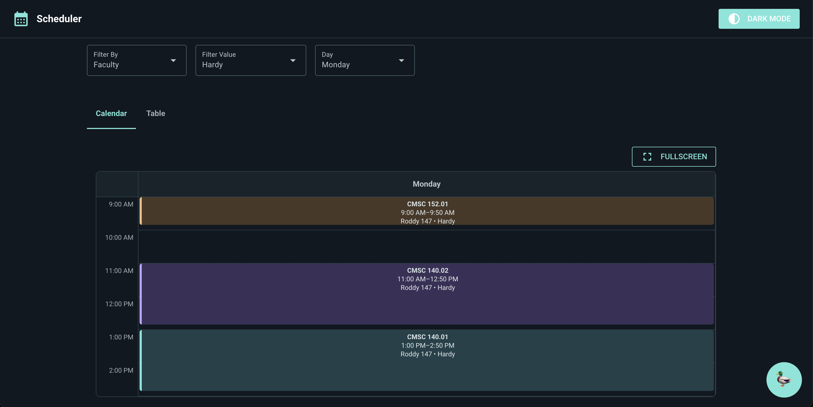

# 2026fa-420-MrLand
## CMSC 420-f26

---

## Contributors

- Nicoletta Beltrante
- Adrian Olweiler
- Renee Watts
- Logan Kaufman
- Dylan Groff
- Micah Schafer
- Sohil Ramani

---

## Overview

MrLand is a course-scheduling application for creating and managing course configurations, generating schedules, and inspecting generated results. The application uses a NiceGUI web interface with three main areas:

1. **Configuration Editor** – create, load, edit, validate, and save scheduler configurations.
2. **Schedule Generator** – generate schedules from an active or saved configuration and monitor generation progress.
3. **Schedule Viewer** – inspect schedules in calendar or table form, filter meetings, and export results.

A floating **Scheduler AI Assistant** is available throughout the GUI. It can inspect and edit the active configuration, validate it, save it, and request schedule generation using a defined set of application tools.

---

## Features

### Configuration Editor

- Create new configuration drafts and load saved JSON configurations.
- Manage courses, faculty, rooms, labs, class patterns, meetings, weekday time blocks, and global generation settings.
- Validate the complete configuration against the scheduler's schema and model rules.
- Preserve incomplete new drafts while preventing an edit from leaving an already-valid configuration invalid.
- Save configurations as JSON under `src/configs/`.

### Schedule Generator

- Select a saved configuration or generate from the active editor configuration.
- Review configured generation limits and optimizer settings.
- Apply temporary overrides for a generation run, including supported time-slot settings.
- Generate schedules in a background thread.
- View progress, generated count, percentage, and completion/failure status.
- Save generated schedules as JSON or CSV.

### Schedule Viewer

- Load saved schedules and view generated results.
- Switch between Calendar and Table views.
- Filter meetings by course, faculty, or room/lab, and combine that filter with a weekday filter.
- View meeting details and overlapping meetings in the calendar.
- Expand the calendar to fullscreen and export from the fullscreen view.
- Export a selected schedule or all generated schedules in CSV or JSON.
- Clear generated results without deleting schedules loaded from files.

### Scheduler AI Assistant

- Open the floating chat assistant from the GUI.
- Ask natural-language questions about the active configuration.
- Inspect and modify supported configuration areas using application tools.
- Validate, save, and generate schedules when requested.
- Receive a clear response when a request is unsupported, missing required information, rejected by validation, or fails at the API/application level.
- See whether successful changes are only applied to the open editor configuration or have also been saved to disk.

AI requests use the OpenAI API and may incur usage charges.

---

## Prerequisites

- **Python 3.12 or newer**
  - Check with `python --version`.
  - Download from [python.org](https://www.python.org/downloads/).
- **Git**
  - Check with `git --version`.
  - Installation instructions: [Git](https://github.com/git-guides/install-git).
- **uv**
  - Check with `uv --version`.
  - Installation instructions: [uv](https://docs.astral.sh/uv/).
- **OpenAI API key** (only required for the AI assistant).

---

## Getting Started

Clone the repository:

```bash
git clone https://github.com/mucsci-students/2026fa-420-MrLand.git
cd 2026fa-420-MrLand
```

Synchronize the project environment and install dependencies:

```bash
uv sync
```

Start the application:

```bash
uv run mrland-gui
```

Open the application in a browser:

```text
http://localhost:8080
```

`uv run` uses the project configuration and lockfile to create/synchronize the environment as needed.

---

## OpenAI AI Assistant Setup

The AI assistant requires an OpenAI API key. The key is read from the `OPENAI_API_KEY` environment variable.

1. Create or obtain an API key through your OpenAI account.
2. In the repository root, copy `.env.example` to `.env`:

   ```bash
   cp .env.example .env
   ```

3. Open `.env` and replace the placeholder with your key:

   ```dotenv
   OPENAI_API_KEY=your-actual-api-key
   ```

4. Save the file and restart the application.

The project calls `load_dotenv()` in `src/ai/scheduler_agent.py`, so a root-level `.env` file is loaded for local runs. **Do not commit `.env` or share your API key.** The repository's `.gitignore` excludes local environment secrets. The `.env.example` file contains only a placeholder.

### Selected model and changing it

The assistant currently uses **`gpt-6-luna`** with the Responses API and medium reasoning effort. The model is selected in:

```text
src/ai/scheduler_agent.py
```

Find the `ChatOpenAI(...)` construction inside `build_scheduler_agent` and change the `model` value:

```python
model = ChatOpenAI(
    model="gpt-6-luna",
    use_responses_api=True,
    reasoning={"effort": "medium"},
    timeout=60,
    max_retries=2,
    api_key=api_key,
)
```

Replace `"gpt-6-luna"` with the model identifier you intend to use and that is available to your OpenAI API account. Restart the application after changing it. The key must also have permission to use the selected model.

---

## Scheduler AI Assistant

### Role and supported requests

The assistant is designed to help users understand and manage scheduler configurations and perform supported application actions. It works with the **currently active configuration** in the Configuration Editor. If no configuration is active, it can answer general scheduler questions, but it cannot inspect, edit, validate, save, or generate from a configuration until one is created or loaded.

Supported requests include:

- Summarize the counts of rooms, labs, courses, and faculty.
- Inspect the full configuration or a supported area: rooms, labs, courses, faculty, class patterns, meetings, time blocks, and global settings.
- Create, update, or delete rooms, labs, courses, faculty members, class patterns, meetings, and weekday time-block sets.
- Change global generation settings, including the schedule limit, optimizer flags, maximum time gap, and minimum time overlap.
- Validate the active configuration.
- Save the active configuration as a JSON file.
- Generate schedules from a valid active configuration.
- List configuration-editor combinations after the user provides the required password.

### Available application tools

The agent uses the following registered tools in `src/ai/agent_tools.py`:

| Tool | Purpose |
|---|---|
| `get_active_configuration_status` | Check whether a configuration is active. |
| `get_config_summary` | Summarize counts of rooms, labs, courses, and faculty. |
| `inspect_configuration` | Inspect the full configuration or a supported area. |
| `create_configuration_item` | Create a supported configuration item. |
| `update_configuration_item` | Update an existing supported item. |
| `delete_configuration_item` | Delete an item after confirmation. |
| `update_configuration_settings` | Change global scheduler settings. |
| `validate_current_config` | Validate the active configuration. |
| `save_configuration` | Validate and save the configuration as JSON. |
| `generate_schedules` | Generate schedules from a valid active configuration. |
| `list_combinations` | List editor combinations after the user supplies the password. |

The assistant must use these tools for configuration changes and application actions. It is instructed not to claim that it changed or saved something unless the corresponding tool/application workflow confirms the result.

### Example requests

The following are representative prompts. The exact item fields still need to satisfy the scheduler's configuration model and validation rules.

**Inspect the current configuration**

```text
Summarize the active configuration and tell me how many rooms, labs,
courses, and faculty members it contains.
```

```text
Inspect the rooms and labs in the active configuration.
```

**Create or edit configuration data**

```text
Add a room named Science 201 with a capacity of 30.
```

```text
Update course CSMC 140 section A so that its capacity is 28.
```

```text
Add a faculty member named Dr. Smith.
```

```text
Change the maximum time gap to 30 minutes.
```

The assistant may ask follow-up questions when required values are missing. It does not invent room availability, assignments, or scheduler constraints.

**Validate, save, and generate**

```text
Validate the current configuration and explain any problems.
```

```text
Save the active configuration as Fall Schedule.
```

```text
Generate schedules using the active configuration.
```

The assistant saves only when explicitly asked. Generation is allowed only after the active configuration passes validation. After generation, the assistant reports the result count and directs the user to the Schedule Viewer rather than reproducing all schedule rows in chat.

### In-memory changes versus saved changes

The assistant distinguishes between editing the active configuration and writing a JSON file:

- **Applied in memory, not saved:** successful edits update the open configuration in the Configuration Editor. They remain part of the current application state, but have not been written to a configuration file.
- **Saved to disk:** when the user explicitly asks the assistant to save, the application validates the configuration and writes it under `src/configs/` as JSON. The assistant reports the saved configuration name.
- **No successful change:** if a request is rejected or cancelled, the assistant must not report it as applied.

The assistant reports which of these outcomes occurred. Saving over an existing configuration requires confirmation.

### Unsupported requests, validation, and failures

- **Unsupported request:** the assistant explains that the requested action is outside its supported scheduler role and, where possible, identifies available actions. It does not pretend to perform unsupported work.
- **Missing information:** the assistant asks a focused follow-up question rather than inventing required values.
- **Validation failure:** the application rejects invalid changes and returns validation details. A new draft may remain incomplete, but an edit to an already-valid configuration cannot leave that configuration invalid.
- **Delete or overwrite:** deleting a configuration item or replacing an existing saved configuration requires an explicit confirmation dialog. Declining cancels the operation.
- **Multi-operation request failure:** a request is treated as one transaction. If one requested operation fails, the application restores the configuration to its state before that request; it does not keep partial changes from that request.
- **OpenAI/API failure:** the assistant displays a user-friendly error for common problems such as a missing or rejected API key, model permissions, exhausted quota, rate limits, network problems, timeouts, or an unavailable OpenAI service. Detailed exception information is written to the server log for debugging; raw API error details are not intentionally shown in the chat.

---

## Using the Schedule Viewer Calendar

Open the **Schedule Viewer** tab after generating schedules or loading a saved schedule.

The filter controls are shared by the Calendar and Table views:

1. Set **Filter By** to `Room / Lab` or `Faculty`.
2. Choose the desired room/lab or faculty member in **Filter Value**.
3. Choose a weekday in **Day** (Monday through Friday), or choose **All Days**.
4. The selected filters are applied together to both the table and calendar.

### Room/lab and day view

Choose **Room / Lab** under **Filter By**, select a room or lab under **Filter Value**, and choose a weekday. The calendar displays meetings assigned to that resource on the selected day. Lab meetings use the lab resource; ordinary in-person meetings use the room resource; online meetings are represented as `Online`.

### Faculty and day view

Choose **Faculty**, select a faculty member, and choose a weekday. The calendar displays that faculty member's meetings on the selected day.

When a weekday is selected, the calendar shows that day's column rather than all weekday columns. Select **All Days** to restore the Monday–Friday calendar. Use **Reset Filters** to clear the filter type, value, and day. The same filtering is applied in the Table view.

Select a calendar event to inspect its meeting details and overlapping meetings. Use **Fullscreen** to expand the calendar; the fullscreen view also provides an **Export** action and an **Exit Fullscreen** control.

---

## Generation Progress

Schedule generation runs in a background thread so the GUI can continue updating while the scheduler searches for results.

The progress panel displays:

- A status message describing the current generation stage.
- A progress bar and percentage based on generated schedules divided by the requested limit.
- A count in the form `Generated X of Y schedules`.
- A spinner while generation is running.

The panel reports one of the terminal outcomes:

- **Complete:** the requested search finishes with one or more schedules. The progress display reaches 100% and directs the user to the Schedule Viewer.
- **No valid schedules:** the search finishes without a schedule. The interface displays a no-valid-schedules message.
- **Failure:** an error occurs. The interface displays a generation-failed message.

A second generation request is rejected while generation is already running. The application also prevents clearing generated results during an active generation.

---

## Screenshots and Representative Workflow

This section demonstrates the primary application workflow, including AI-assisted
configuration editing, schedule generation, and schedule visualization.

### 1. AI Assistant – Configuration Editing

1. The user loads a valid scheduler configuration.
2. The user submits a one-off AI request to inspect or modify configuration data.
3. The AI calls a supported application tool.
4. The application validates and applies the operation, or explains why it failed while preserving valid state.
5. The Configuration Editor reflects a successful change.



6. The user requests that the updated configuration be saved.



### 2. Schedule Generation Progress

1. The user starts generation through the AI tool or the ordinary GUI.
2. The GUI shows a progress bar until generation finishes.



3. The application reports the outcome and makes successful results available in the Viewer.



### 3. Room/Lab-by-Day Calendar

1. The user loads a new schedule or uses the generated schedules
2. The user inspects a selected schedule by room or lab and day.



### 4. Faculty-by-Day Calendar

1. The user loads a new schedule or uses the generated schedules
2. The user inspects the same schedule by faculty and day.



---

## Configuration Files and Validation

The scheduler stores configuration files as JSON under:

```text
src/configs/
```

A configuration can include:

- Courses and faculty members
- Rooms and labs
- Class patterns and meetings
- Weekday time blocks
- Conflicts and scheduling constraints
- Generation limits and optimizer settings

The editor validates the complete configuration against the schema at:

[`src/schemas/combined-config.schema.json`](src/schemas/combined-config.schema.json)

It also applies the scheduler library's cross-field and cross-reference validation rules. No Scheduler API server is needed for this validation.

---

## Development

Install or synchronize development dependencies:

```bash
uv sync
```

Add dependencies with `uv add <package>` or development dependencies with `uv add --dev <package>`. Commit `pyproject.toml` and `uv.lock` together.

### Local build and quality checks

Run the same checks configured in GitHub Actions:

| Check | Command |
|---|---|
| Build source distribution and wheel | `uv build` |
| Run all tests | `uv run pytest` |
| Run tests and Model coverage report | `uv run pytest --cov --cov-report=term-missing` |
| Run tests and produce Codecov XML | `uv run pytest --cov --cov-report=xml --cov-report=term-missing` |
| Ruff lint | `uv run ruff check .` |
| Check formatting without changing files | `uv run ruff format --check .` |
| Apply Ruff formatting | `uv run ruff format .` |
| Type checking | `uv run ty check` |

To apply automatic Ruff lint fixes locally, use:

```bash
uv run ruff check --fix .
```

The CI workflow checks formatting and lint without applying fixes, so run the non-fixing checks before pushing.

---

## GitHub Actions and Secrets

The CI workflow is defined in:

```text
.github/workflows/ci.yaml
```

It runs on pushes and pull requests. The workflow synchronizes dependencies from the lockfile and runs:

- Ruff linting
- Ruff formatting verification
- `ty` type checking
- The pytest suite with Model coverage on Ubuntu, macOS, and Windows
- A package build that creates a source distribution and wheel

The Codecov upload runs from the Ubuntu test job. GitHub Actions passes the repository secret `CODECOV_TOKEN` to the Codecov action using the workflow expression:

```yaml
token: ${{ secrets.CODECOV_TOKEN }}
```

To configure it, add the Codecov upload token in the repository's **Settings → Secrets and variables → Actions → New repository secret**, with the exact name `CODECOV_TOKEN`. The token is not written into the repository or README.

The CI workflow does **not** pass an OpenAI API key to the test jobs. The AI assistant's key is a local developer setting in `.env`; automated tests should not require a live OpenAI API key.

---

## Test Coverage and Codecov

Coverage is configured in `pyproject.toml`:

```toml
[tool.coverage.run]
source = ["src/models"]
branch = false

[tool.coverage.report]
fail_under = 80
show_missing = true
skip_empty = true
```

- **Coverage scope:** team-written Model code under `src/models/`.
- **Excluded from the measured source scope:** views, controllers, tests, and the third-party `course-constraint-scheduler` library.
- **Coverage metric:** line coverage; branch coverage is disabled.
- **Minimum:** 80%. The local pytest coverage command and CI test job fail if coverage is below this threshold.

The Codecov configuration is in [`codecov.yaml`](codecov.yaml). The CI job uploads `coverage.xml` with the `model` flag. Codecov's project status checks the `model` flag against an 80% target with a 0% threshold; the model patch status is informational.

**Latest Codecov result:** 85.63%

---

## Design Patterns

The application uses an MVC organization and includes Strategy, Memento, and Composite implementations.

### 1. Model–View–Controller (MVC)

- **Locations:** `src/models/`, `src/views/`, and `src/controllers/`.
- **How it is used:** Models own configuration and schedule state, validation, and persistence-related behavior. Views build the NiceGUI interface. Controllers coordinate user actions and connect views to models and scheduler operations.
- **Why it fits:** Separating state and application rules from GUI code makes the scheduler easier to test and maintain without putting all behavior into the NiceGUI views.

### 2. Strategy

- **Locations:** `src/models/schedule_files.py` and `src/models/schedule_viewer_model.py`.
- **How it is used:** `ScheduleExportStrategy` defines a shared serialization interface. `CsvScheduleExportStrategy` and `JsonScheduleExportStrategy` implement the format-specific behavior. `SCHEDULE_EXPORT_STRATEGIES` selects a strategy based on the requested format, and `ScheduleViewerModel.serialize` uses it for schedule exports.
- **Why it fits:** CSV and JSON are interchangeable export behaviors for the same schedule records. The viewer model can use either serializer without embedding all format-specific serialization logic.

### 3. Memento

- **Locations:** `src/controllers/configuration_controller.py` and `src/views/ai_assistant.py`.
- **How it is used:** `ConfigurationMemento` stores a deep-copy snapshot of the active configuration and its validity state. The AI assistant creates a snapshot before processing a request and restores it if one of the requested operations fails.
- **Why it fits:** The application can roll back a multi-operation AI request to the exact configuration state that existed before the request, rather than leaving partial edits behind.

### 4. Composite

- **Location:** `src/views/theme.py`.
- **How it is used:** `ThemeComponent` defines the common interface. `ThemeLeaf` represents one theme-script operation, while `ThemeComposite` contains multiple components and combines their scripts through the same `script()` interface. New theme operations can be added to the composite.
- **Why it fits:** Individual theme operations and groups of operations can be treated uniformly, allowing a theme to be assembled from smaller reusable pieces.

---

## Project Structure

```text
.
├── .github/
│   └── workflows/
│       ├── ci.yaml
│       └── release.yaml
├── .env.example
├── README.md
├── codecov.yaml
├── pyproject.toml
├── uv.lock
├── screenshots/
├── src/
│   ├── ai/
│   │   ├── agent_tools.py
│   │   ├── api_errors.py
│   │   └── scheduler_agent.py
│   ├── configs/
│   ├── controllers/
│   ├── models/
│   ├── schemas/
│   └── views/
└── tests/
```

The application follows MVC package organization: configuration and schedule state are in `models`, application coordination is in `controllers`, and NiceGUI pages/components are in `views`. AI agent setup and tool definitions are grouped in `src/ai/`.

---

## Known Limitations

- The AI assistant requires a valid OpenAI API key, internet access, and API access to the configured model. API availability, rate limits, permissions, and account quota can affect requests.
- AI configuration operations require an active configuration in the Configuration Editor. The assistant cannot edit a configuration before one is created or loaded.
- The assistant is limited to its registered tools and scheduler domain. It is not a general-purpose application operator and does not perform arbitrary GUI or file-system actions.
- The assistant asks for clarification when required configuration values are missing; it does not infer unprovided resource availability or assignments.
- Deleting items and overwriting an existing saved configuration require confirmation.
- AI changes are not automatically saved. They are applied to the active in-memory configuration until the user explicitly requests a save.
- Calendar appearance and layout should still be checked manually at different screen sizes. Automated tests cover application logic and time/filter behavior, not every browser rendering condition.
- Codecov's latest measured percentage is not embedded in the source repository; consult the Codecov dashboard for the current report.

---

## License

This project is licensed under the terms of the included [LICENSE](LICENSE) file.
